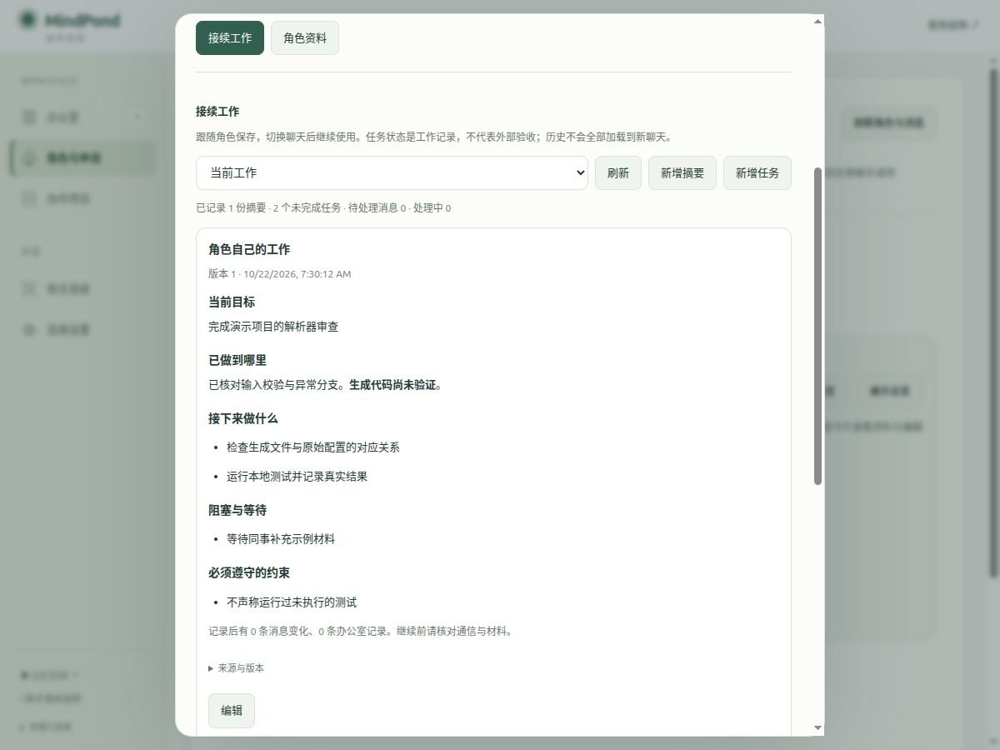

# 换聊天后接续角色工作

角色身份、当前工作和长期知识分别保存。批准角色切换后，新 Codex / OpenCode 聊天使用同一角色 ID，直接读取接续摘要与未完成任务，无须先猜测搜索词；旧聊天失去角色写入权。

## 人类在哪里查看

打开 **协作办公室 → 角色与申请 → 点角色卡片 → 接续工作**。

- **当前工作**：显示目标、已验证进度、下一步、阻塞、约束、来源和未完成任务。可新增摘要、任务，或编辑已有条目。
- **已完成**：查看明确完成或取消的任务；可以封存。
- **已封存**：正文和历史仍保留。点“恢复到已完成”后回到已完成列表；编辑为待办/进行中可重新开启。
- **阶段历史**：按版本读取之前的摘要、任务变更与封存依据。不会全部加载到新聊天。
- **角色资料**：编辑名字、能力介绍；当前连接仍显示在上方，可切换到另一宿主和聊天。

“工作范围”可选角色自己的工作或一个办公室。办公室工作仍是该角色的接续资料，不会自动发布给其他成员；通用办公室经验和规范应通过 `memory_save(officeId)` 存入共享知识。



## 新聊天的恢复步骤

1. 目标聊天调用 `role_sync`，人类核对真实聊天 ID，并在角色详情切换连接。
2. 新聊天通过独立 Memory MCP 调用 `memory_identity`，核对角色及实例。
3. 调用 `memory_resume`；有 `nextCursor` 时继续读取完整分页。返回当前摘要和未完成任务，不用相似度排序决定它们是否出现。
4. 先处理 `role_sync` 的暂停/停止等控制要求，再从 `afterSeq=0` 恢复处理中消息，核对新消息和 `office_context` 中的材料。
5. 根据当前任务调用 `memory_brief`，按需查阅技能和相关经验，再继续工作。

摘要的记录时间不是已读游标，也不证明此前所有消息均处理过。“记录后变化”包含在该时间点及之后的消息/任务/办公室记录变化，只是核对提醒。来源版本须按实际材料检查。

## agent 记录一次阶段进展

高级操作通过 `memory_capabilities` 发现，先用 `memory_action({"tool":"memory_continuity_checkpoint","describe":true})` 读取实时 schema。首次写入 `expectedRevision=0`：

```json
{
  "tool": "memory_continuity_checkpoint",
  "arguments": {
    "expectedRevision": 0,
    "key": "parser-review-stage-1",
    "reason": "已核对解析器，准备交接生成代码检查",
    "summary": {
      "goal": "完成解析器及生成代码审查",
      "progress": "输入校验与错误分支已核对。生成产物尚未验证。",
      "constraints": ["不声称执行过未运行的测试"],
      "blockers": ["等待补充生成配置"],
      "nextSteps": ["核对生成配置与产物", "运行本地检查并记录实际结果"],
      "sources": [{"kind":"external","uri":"repo:src/parser.ts","revision":"实际提交 SHA"}]
    },
    "tasks": [{
      "id": "review-generated-code",
      "expectedRevision": 0,
      "title": "核对生成代码",
      "status": "doing",
      "priority": 3,
      "progress": "已读源码，尚未核对生成产物",
      "nextSteps": ["读取生成配置"]
    }]
  }
}
```

摘要是一个范围内当前状态的完整替换；每次修改需保留仍然有效的约束、阻塞与下一步。`tasks` 仅更新列出的任务，省略的任务不会删除。任务 ID 在角色内稳定，不能通过改变 `officeId` 转移范围。每条任务有独立版本；摘要及其最多八条任务在同一事务提交，任何版本冲突全部回滚。

只更新一件任务用 `memory_continuity_task`。状态可为 `todo/doing/blocked/waiting/done/cancelled`；优先级 0–3，3 最高。新建或重新开启后，单角色最多 200 个未完成任务，不能靠封存未完成承诺绕过限制。每条完整记录最大 12 KB，一次摘要提交最大 32 KB；详细材料放到可引用的记忆、消息或办公室材料。

同一个操作 key 和相同内容可恢复丢失的回执；改变内容会报 `idempotency_conflict`。`stale_version` 时先重读，不能用新 key 强行覆盖旧版本。原 session 已发出但尚未写入的操作，也会在实际事务中重查绑定。

## 来源、办公室与封存

来源支持：`memory` 的实际 id 和可选更新时间版本、`message` 的实际 id、`material` 的实际 id，或带版本的 `external` URI。服务器检查内部引用是否可读；外部仓库和文件由宿主核对，MindPond 不自行读取路径。

办公室记忆、消息和材料的引用必须放到对应 `officeId` 的工作范围。角色退出或失去办公室权限后，对应摘要、任务、历史和旧写入回执均不可访问；角色自己的工作仍保留。暂停/归档办公室对角色只读，人类仍可管理。办公室删除后接续资料保留给人类，编号不能复用；角色永久删除会删除其接续资料和历史，删除前的影响预览会列出数量。长期图记忆按原有保留规则处理。

阶段摘要更新会保留历史版本。已完成任务退出默认启动内容；明确封存后仍可读取和恢复。未完成任务必须先如实完成或明确取消，不能因为时间久、访问少、内容不重要而直接封存。长期技能、规范和用户约束不受此任务封存操作影响。

## 边界与验收

恢复资料是 agent/人类记录的进度，不是外部验收结论。没有摘要时返回明确空状态，引导从消息和材料重建；不会推测未保存的工作。MCP 不会自动读取另一个聊天的隐藏上下文，也不能自行启动停止的宿主。提示会要求阶段完成、交接、上下文丢失前记录，但宿主突然中断时只能恢复已持久保存的内容。

`npm run verify:role-continuity` 使用真实认证 HTTP MCP、Codex/OpenCode 两种聊天标识、独立 SQLite 和前端处理函数，验证切换接续、事务中撤权、版本冲突、幂等、原子回滚、权限、分页预算、历史、封存与恢复。`verify:opencode-native` 覆盖实际 Node worker 重连；`verify:owner-workbench` 覆盖人类管理、CSRF、版本和停用角色。全部使用合成资料，不能据此宣称真实模型始终会主动记录或性能已经过生产负载验收。

部署新增四张接续资料表及查询索引，不增加第三方依赖、不搬迁或删除既有记忆。更新和回退要求见[升级历史](history.md)。
